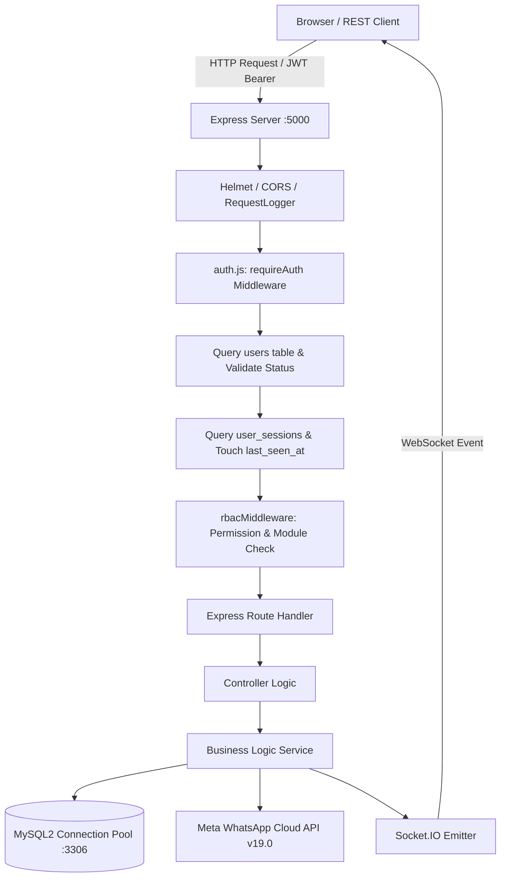
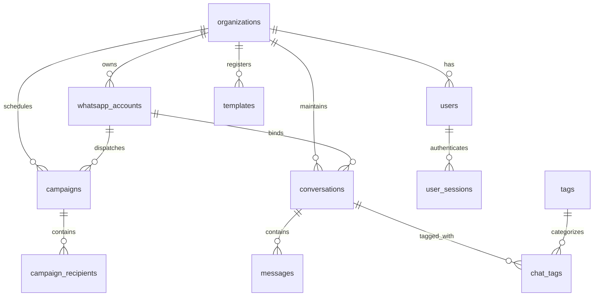
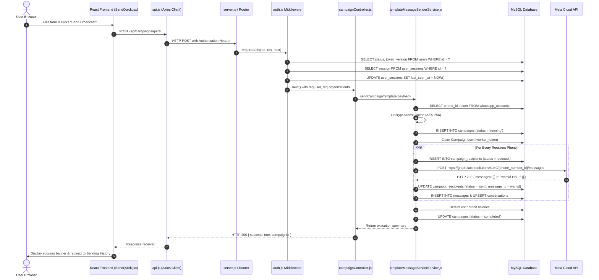
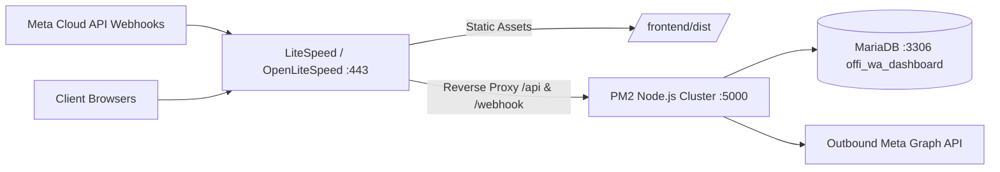

# PROJECT MASTER TECHNICAL DOCUMENTATION
**Project Name:** Official WABA (WhatsApp Business API Platform)  
**Live Application URL:** https://officialwaba.com  
**Document Classification:** Internal Technical Architecture & Engineering Manual  
**Author:** Principal Software Architect, Production Reliability Auditor  
**Date of Audit:** November 2026  
**Audited Codebase Root:** `C:\Users\UV Digital\backup-file-6-11-2026_new_code_wapp`  

---

## 1. Project Overview & Business Purpose

**Official WABA** is an enterprise-grade multi-tenant SaaS application that integrates directly with Meta's Official WhatsApp Cloud API (Graph API). It provides businesses, agencies, and resellers with:
- **Broadcasting & Campaign Automation:** Quick Broadcasts, CSV-driven bulk messaging, Tag/Group segmentation, Scheduled campaigns, and automated Birthday messaging.
- **Interactive Multi-Agent Team Chat Inbox:** Real-time bi-directional messaging with live contact status, unread counters, tag assignments, contact history, media previews, and agent attribution.
- **Visual No-Code Chatbot Engine:** Drag-and-drop conversational node workflows with button replies, list interactive messages, conditional branching, media responses, and session persistence.
- **Official Meta Template & Account Lifecycle:** Meta Embedded Signup with Facebook Login SDK, template creation and synchronization with Meta review statuses, quality rating monitoring, and phone number provisioning.
- **Multi-Tier Multi-Tenant RBAC:** Hierarchical roles (Super Admin, Reseller, Admin/User, Team Member/Staff, Agent) with tenant data isolation, per-device session management, and granular permission gates.
- **Credit & Subscription Billing:** Balance accounting, per-feature credit allocation, days-based SaaS access limits, and Meta conversation billing insights.
- **External Developer REST API:** API key-authenticated endpoints for programmatic WhatsApp message dispatch (OTP, text, templates, media, groups, tags, CleverTap webhook integrations).

---

## 2. Technology Stack & Versions

### Backend
- **Runtime:** Node.js (Active local environment: v24.21.0, ES Modules `"type": "module"`)
- **HTTP Framework:** Express.js `^4.19.2`
- **Database Driver:** `mysql2/promise` `^3.11.3` (Connection Pooling, prepared statements)
- **Real-Time Communication:** `socket.io` `^4.8.3` (WebSockets with polling fallback)
- **Security & Headers:** `helmet` `^8.2.0`, `cors` `^2.8.5`, `bcryptjs` `^2.4.3`, `jsonwebtoken` `^9.0.2`
- **HTTP Client:** `axios` `^1.18.1`
- **File & Media Processing:** `multer` `^2.2.0`, `sharp` `^0.35.4`
- **Cron / Schedulers:** `node-cron` `^4.6.0`, native Node.js `setInterval` timers with database lock leasing
- **Logging:** `morgan` `^1.11.0` and custom file/console stream logger (`src/utils/logger.js`)

### Frontend
- **Framework & Bundler:** React `^18.3.1`, Vite `^5.4.6` / `^5.4.21` (`@vitejs/plugin-react` `^4.3.1`)
- **Routing:** `react-router-dom` `^6.26.2`
- **State & Stores:** React Context (`AuthContext`, `TitleContext`, `LoadingContext`, `ThemeContext`), `zustand` `^5.0.14` (Flow builder state)
- **UI Components & Icons:** `lucide-react` `^1.28.0`, `react-icons` `^5.7.0`, `bootstrap` `^5.3.8`, `framer-motion` `^12.43.0`
- **Charts & Data Viz:** `recharts` `^2.12.7`
- **Flow Engine:** `@xyflow/react` `^12.11.2`
- **Export & Sheets:** `xlsx` `^0.18.5`, `jspdf` `^4.2.1`, `html2canvas` `^1.4.1`

### Infrastructure & Databases
- **Production OS / Stack:** Linux VPS, CyberPanel, LiteSpeed/OpenLiteSpeed reverse proxy, PM2 process daemon
- **Production Database:** MariaDB / MySQL (`offi_wa_dashboard`)
- **Local Development Database:** MySQL 8.0 / MariaDB on XAMPP Windows (`new_waba_db-6-11-26` on port 3306)
- **External Dependencies:** Meta Graph API `v19.0` / `v20.0`, Facebook JavaScript SDK (`connect.facebook.net/en_US/sdk.js`)

---

## 3. Complete Folder & File Structure

```
backup-file-6-11-2026_new_code_wapp/
│
├── server.js                          # Node.js Express server entry point & socket initialization
├── package.json                       # Backend dependencies and run scripts
├── nodemon.json                       # Dev server file-watcher configuration
├── ecosystem.config.js                # PM2 process manager configuration for production
├── .env                               # Active environment variables (DB, Ports, Meta secrets)
├── full_backup.sql                    # SQL dump containing full production schema & initial seed
│
├── src/                               # Backend Source Directory
│   ├── config/
│   │   ├── db.js                      # MySQL2 connection pool setup (timezone +05:30, 20 max conn)
│   │   └── whatsapp.js                # Meta Graph API base URL, tokens, and fallback credentials
│   │
│   ├── controllers/                   # Route Request Handlers
│   │   ├── authController.js          # User & agent login, logout, profile update, sessions
│   │   ├── campaignController.js      # Campaign submission, scheduling, cancel, manual run
│   │   ├── chatController.js          # Conversations, message threads, media proxy, chat reply
│   │   ├── chatbotController.js       # Visual chatbot flows CRUD, nodes, edges, media
│   │   ├── creditController.js        # Credit balance, assignment, deduction, admin history
│   │   ├── dashboardController.js     # Top KPI cards and outgoing message analytics chart data
│   │   ├── developerApiController.js  # External programmatic REST API for 3rd-party software
│   │   ├── followupController.js      # Drip campaign series, auto-responders
│   │   ├── messageController.js       # Ad-hoc text/media message dispatch
│   │   ├── metaBillingController.js   # Conversation charges, marketing vs service tier billing
│   │   ├── metaTemplateController.js  # Fetching live templates from Meta Graph API
│   │   ├── reportController.js        # Sending history reports, campaign recipient details, resend
│   │   ├── tagController.js           # Contact tags, tagging numbers, tag-to-chat associations
│   │   ├── teamMemberController.js    # Sub-accounts, staff permissions, device restrictions
│   │   ├── templateController.js      # Local DB template management
│   │   ├── userController.js          # User CRUD, password resets, days allocations, module access
│   │   ├── webhookController.js       # Meta webhook verification and incoming message/status ingestion
│   │   └── whatsappAccountController.js # Multi-account onboarding, token updates, WABA info fetch
│   │
│   ├── db/                            # Database Schema & Migrations
│   │   ├── migrateAndSeed.js          # Startup multi-tenant column and table migrations
│   │   ├── setupDatabase.js           # Clean schema creation and database initialisation
│   │   └── migrations/                # 20+ SQL migration scripts (001_campaigns to 019_dedicated_team)
│   │
│   ├── middleware/                    # Express Middleware Functions
│   │   ├── auth.js                    # JWT Bearer token authentication, user/session validation
│   │   ├── apiKeyAuth.js              # Header-based X-API-Key validator for developer API
│   │   ├── asyncHandler.js            # Promise rejection catch-all wrapper
│   │   ├── developerRateLimiter.js    # Rate limiting for external developer endpoints
│   │   ├── errorHandler.js            # Centralized API error formatter and JSON responder
│   │   ├── rbacMiddleware.js          # Role-based and permission-based route guards
│   │   └── requestLogger.js           # HTTP incoming request metrics logger
│   │
│   ├── routes/                        # Express API Routers
│   │   ├── authRoutes.js              # /api/auth (login, me, profile, sessions)
│   │   ├── campaignRoutes.js          # /api/campaigns (bulk dispatch, schedules, cancels)
│   │   ├── chatRoutes.js              # /api/chat (conversations, messages, media proxy, read status)
│   │   ├── chatbotRoutes.js           # /api/chatbot (flow builder, sessions, node executions)
│   │   ├── creditRoutes.js            # /api/credits (balance, assign, admin ledger)
│   │   ├── dashboardRoutes.js         # /api/dashboard (stats, message-stats)
│   │   ├── developerApiRoutes.js      # /api/v1/developer (programmatic dispatch)
│   │   ├── followupRoutes.js          # /api/followups
│   │   ├── message.js                 # /api/message, /api/campaign/scheduled, /api/reports
│   │   ├── metaBillingRoutes.js       # /api/meta (billing insights)
│   │   ├── metaTemplate.js            # /api/meta-templates, /api/meta/templates
│   │   ├── organizationRoutes.js      # /api/organizations
│   │   ├── permissionRoutes.js        # /api/permissions
│   │   ├── resellerRoutes.js          # /api/resellers
│   │   ├── tagRoutes.js               # /api/tags
│   │   ├── teamMemberRoutes.js        # /api/team-members
│   │   ├── templateRoutes.js          # /api/templates
│   │   ├── userRoutes.js              # /api/users
│   │   ├── webhook.js                 # /webhook, /api/webhook
│   │   └── whatsappAccountRoutes.js   # /api/whatsapp, /api/whatsapp-accounts, /api/numbers
│   │
│   ├── services/                      # Core Business Logic & Orchestration
│   │   ├── apiKeyService.js           # Key generation and tenant scoping
│   │   ├── auditLogService.js         # Security and administrative event auditing
│   │   ├── birthdaySchedulerService.js# Daily automated birthday campaign worker
│   │   ├── blacklistService.js        # Opt-out phone number validation and checking
│   │   ├── campaignResendService.js   # Re-queueing and dispatching failed recipient records
│   │   ├── chatbotEngineService.js    # Stateful conversation graph evaluator
│   │   ├── chatService.js             # Chat message recording, conversation upserts
│   │   ├── creditService.js           # Multi-tenant credit checks and atomic deductions
│   │   ├── developerApiService.js     # Developer API pipeline and payload validators
│   │   ├── followupScheduler.js       # Multi-step drip campaign scheduler
│   │   ├── metaBillingService.js      # Meta Graph conversation analytics scraper
│   │   ├── metaWhatsAppService.js     # Thin wrapper dispatching to templateMessageSenderService
│   │   ├── schedulerService.js        # 5-second persistent campaign queue processor
│   │   ├── templateMessageSenderService.js # Authoritative central single and batch message sender
│   │   ├── templateService.js         # Meta Graph template synchronizer and local caching
│   │   └── whatsappService.js         # Ad-hoc text/media dispatch via Meta Graph API
│   │
│   └── utils/                         # Helper Utilities
│       ├── encryption.js              # AES-256 token encryption, decryption, and masking
│       ├── logger.js                  # Standardized ANSI colored server logger
│       ├── metaErrorHelper.js         # Meta error code translations to user-friendly messages
│       ├── phoneUtils.js              # 10-digit suffix extraction and normalization
│       ├── saveWebhook.js             # Raw payload debug archiver
│       ├── socket.js                  # Socket.IO emitter helpers (`emitToOrganization`)
│       └── userAccessHelper.js        # Days-based subscription status calculator
│
├── frontend/                          # React + Vite Single Page Application
│   ├── index.html                     # HTML root, viewport and Meta SDK load scripts
│   ├── vite.config.js                 # Vite development proxy configuration
│   ├── package.json                   # Frontend dependencies
│   ├── src/
│   │   ├── App.jsx                    # Route hierarchy, auth route guards, role switchers
│   │   ├── config.js                  # Single source of truth for BASE_URL & API_BASE_URL
│   │   ├── context/
│   │   │   ├── AuthContext.jsx        # JWT state, user payload, permissions, login/logout
│   │   │   ├── TitleContext.jsx       # Browser tab and header title manager
│   │   │   ├── ThemeContext.jsx       # Dark / Light theme toggle
│   │   │   └── LoadingContext.jsx     # Global spinner coordinator
│   │   ├── services/
│   │   │   ├── api.js                 # Central Axios instance with JWT interceptors
│   │   │   ├── facebookSdk.js         # Meta Embedded Signup SDK initializer
│   │   │   └── tagService.js          # Contact tag network calls
│   │   ├── components/                # Reusable UI Components
│   │   │   ├── Layout.jsx             # Shell wrapper with Topbar, Sidebar, and Content Outlet
│   │   │   ├── Sidebar.jsx            # Dynamic multi-tenant sidebar with module gating
│   │   │   ├── Topbar.jsx             # Active WhatsApp number selector, credit badge, profile
│   │   │   ├── WhatsAppMobilePreview.jsx # Live WhatsApp chat phone mockup preview
│   │   │   ├── MediaHeaderUpload.jsx  # Image/Video/PDF template header uploader
│   │   │   └── TemplateVariablesInput.jsx # Dynamic {{1}}, {{2}} template variable form
│   │   └── pages/                     # Routed Application Pages
│   │       ├── Dashboard.jsx          # KPI analytics, charts, embedded signup button
│   │       ├── SendQuick.jsx          # Quick broadcast form, template picker, preview
│   │       ├── SendCsv.jsx            # CSV upload and column-to-variable mapper
│   │       ├── SendByTags.jsx         # Contact segment broadcast by tag
│   │       ├── SendByGroup.jsx        # Contact segment broadcast by group
│   │       ├── SendBirthday.jsx       # Automated anniversary/birthday campaign config
│   │       ├── SendingHistory.jsx     # Campaign and message dispatch logs, recipient modal
│   │       ├── ScheduledLog.jsx       # Queue of pending scheduled campaigns with cancel/run-now
│   │       ├── Chat.jsx               # Real-time multi-agent WhatsApp chat inbox
│   │       ├── Chatbot.jsx            # Chatbot list and status switchers
│   │       ├── ChatbotFlowBuilder.jsx # Node-based interactive bot designer
│   │       ├── ManageOfficialNumbers.jsx # WABA accounts, quality rating, and token updates
│   │       ├── ManageOfficialTemplate.jsx # Meta approved templates table and creator
│   │       ├── ManageUser.jsx         # Sub-user and customer administration
│   │       ├── ManageReseller.jsx     # Reseller tier administration
│   │       ├── ManageCredit.jsx       # Tenant wallet balance and transaction ledger
│   │       └── MetaBillingInsights.jsx# Real-time Meta billing analytics and category usage
│
└── uploads/                           # Static Media Storage Directory
    ├── chatbot/                       # PDFs, PPTXs, images sent by chatbots
    ├── chat-media/                    # Media sent and received in the live chat inbox
    └── templates/                     # Media headers uploaded for official Meta templates
```

---

## 4. Frontend Architecture & Page-by-Page Explanation

The frontend is built as a single-page React application utilizing `react-router-dom` v6. Routes are wrapped within an `AuthContext` provider and rendered inside a common `Layout` component that renders a navigation `Sidebar` and `Topbar`.

### Page Directory & Behavior

1. **Dashboard (`/dashboard` - `frontend/src/pages/Dashboard.jsx`)**
   - Displays organization-level KPIs: Active WhatsApp Business Account, Verification Status, Quality Rating, Total Sent, Delivered, Read, and Failed messages.
   - Houses the "Connect WhatsApp" button that triggers the Meta Embedded Signup modal via `facebookSdk.js`.
   - Embeds the "Outgoing Message Analytics" chart using `recharts` for viewing message traffic grouped by date ranges (7d, 30d, month, custom).
   - Fetches credit wallet balances and Meta billing insights concurrently on mount.

2. **Quick Broadcast (`/send-wa/quick` - `frontend/src/pages/SendQuick.jsx`)**
   - Primary single-campaign broadcast interface.
   - Allows users to enter one or multiple phone numbers manually (comma or newline separated).
   - Loads approved Meta templates dynamically based on the selected WhatsApp account.
   - Automatically parses template body text for parameter placeholders (`{{1}}`, `{{2}}`, etc.) and renders corresponding input fields.
   - Detects `HEADER` format (Image, Video, Document) and provides the `MediaHeaderUpload` component.
   - Features a live interactive preview (`WhatsAppMobilePreview`) that formats text and displays variables in real time.
   - Provides an option to dispatch immediately or schedule for future execution via `ScheduleModal`.

3. **CSV Campaign (`/send-wa/csv` - `frontend/src/pages/SendCsv.jsx`)**
   - Enables bulk message dispatch by uploading `.csv` or `.xlsx` files.
   - Reads sheet headers using the `xlsx` library and provides dropdown mapping between spreadsheet columns and template variables.
   - Implements client-side phone number validation and duplicate detection before submission.

4. **Segment by Tags (`/send-wa/tags` - `frontend/src/pages/SendByTags.jsx`)**
   - Targets contacts previously categorized with tags.
   - Queries `/api/tags` and `/api/tags/:id/contacts` to populate recipient lists automatically without manual number entry.

5. **Segment by Group (`/send-wa/group` - `frontend/src/pages/SendByGroup.jsx`)**
   - Selects custom user-defined contact groups to dispatch bulk template broadcasts.

6. **Birthday Campaigns (`/send-wa/birthday` - `frontend/src/pages/SendBirthday.jsx`)**
   - Configures automatic daily birthday broadcasts. Associates a contact list possessing birth dates with an approved template, scheduled to run daily via `birthdaySchedulerService.js`.

7. **Sending History (`/reports/sending-history` - `frontend/src/pages/SendingHistory.jsx`)**
   - High-density report table displaying all completed, running, and failed campaigns.
   - Displays real-time progress counters: Total, Processed, Pending, Sent, Delivered, Read, Failed.
   - Contains a "View Recipients" modal (`/reports/campaign/:id/recipients`) that displays individual contact delivery timestamps, error messages, and a "Resend" action.
   - Subscribes to Socket.IO events (`sending_history_updated`) to refresh counters in real time.

8. **Scheduled Log (`/reports/scheduled-log` - `frontend/src/pages/ScheduledLog.jsx`)**
   - Displays upcoming scheduled broadcasts.
   - Allows operators to cancel a queued broadcast or click "Run Now" to trigger immediate dispatch.

9. **Live Chat Inbox (`/chat` - `frontend/src/pages/Chat.jsx`)**
   - Bi-directional customer support messaging portal.
   - Left Pane: Conversation list showing contact names, phone numbers, last message snippets, relative timestamps, and unread badges. Supports search and day-filtering (7, 30, 150 days, or all).
   - Right Pane: Active chat thread showing chronological message bubbles, delivery ticks (sent, delivered, read), media attachments (images, video, documents, audio), interactive template cards, and quick reply buttons.
   - Includes template picker for sending approved templates directly inside an active support session.
   - Supports contact tagging directly from the chat header.

10. **Chatbot Flow Builder (`/chatbot` & `/chatbot/builder/:id` - `ChatbotFlowBuilder.jsx`)**
    - Visual node graph engine built on `@xyflow/react`.
    - Nodes include: Start Node, Text Message Node, Media Node, Interactive Button Node, List Menu Node, and Delay Node.
    - Persists node positions and edge connections to MySQL via `/api/chatbot/flow`.

11. **WhatsApp Number Management (`/setting/manage-official-numbers` - `ManageOfficialNumbers.jsx`)**
    - Multi-account configuration center. Lists all provisioned Phone Number IDs, WABA IDs, verified business names, and connection statuses.
    - Provides access token update modals and manual Meta status sync.

12. **Official Templates Management (`/template/manage-official-template` - `ManageOfficialTemplate.jsx`)**
    - Displays all templates registered under the WABA.
    - Features a template creation wizard (`AddOfficialTemplate.jsx`) that sends template schemas to Meta's Graph API for official approval.

13. **User & Reseller Management (`ManageUser.jsx`, `ManageReseller.jsx`)**
    - Administrative control center for creating tenant accounts, allocating wallet credits, setting subscription expiry dates, and toggling sidebar module visibility.

---

## 5. Backend Architecture & Request Lifecycle



### Request Lifecycle Breakdown
1. **Entry Point (`server.js`):** Every incoming HTTP request passes through `helmet({ contentSecurityPolicy: false })`, permissive CORS allowing configured origins and custom headers (`X-Account-ID`, `X-Device-ID`), `express.json({ limit: '50mb' })`, and HTTP request loggers.
2. **Static Route Bypass:** Requests matching `/uploads/*` or `/api/uploads/*` are served directly by `express.static` without invoking database middleware.
3. **Authentication Layer (`src/middleware/auth.js`):**
   - Extracts the `Authorization: Bearer <token>` header.
   - Verifies JWT integrity using `process.env.JWT_SECRET`.
   - Executes an immediate database query to verify if the user account is `Active` and that `token_version` matches.
   - If a `session_id` is present in the token payload, verifies against `user_sessions` and executes an `UPDATE user_sessions SET last_seen_at = NOW()` query.
   - Calculates dynamic subscription validity metrics via `calculateDaysMetrics`.
4. **Tenant Scoping:** Attaches `req.organizationId` and `req.user` to the request object. Controllers use these properties to ensure queries remain strictly scoped to the tenant.
5. **Controller & Service Layer:** The controller unpacks parameters, delegates execution to service modules (`templateMessageSenderService.js`, `chatService.js`, etc.), acquires short-lived connections from `pool`, executes prepared SQL statements, and dispatches external calls to Meta Graph API when necessary.
6. **Real-Time Notification:** After updating state, services broadcast WebSocket events via `src/utils/socket.js` targeting specific organization rooms (`org_${organizationId}`).

---

## 6. Authentication, JWT, Permissions & Middleware

### Token Generation & Payload Structure
JWT tokens are minted in `src/controllers/authController.js` upon successful bcrypt password comparison:
```json
{
  "id": 1,
  "username": "admin",
  "role": "Super Admin",
  "organization_id": 1,
  "token_version": 0,
  "session_id": "uuid-v4-string",
  "principal_type": "user"
}
```
Default expiration: `24h` (`JWT_EXPIRES_IN=24h`).

### Authentication Middleware (`src/middleware/auth.js`)
- `requireAuth`: Validates JWT, verifies user active state in DB, checks `user_sessions` revocation/block status, and refreshes `last_seen_at`.
- `requireAdmin`: Enforces `role IN ('Super Admin', 'Admin')`.
- `requireSuperAdmin`: Restricts access exclusively to `Super Admin`.

### Permissions & RBAC (`src/middleware/rbacMiddleware.js`)
Sub-users and team members possess a `permissions` JSON column in the `users` table. The `requirePermission(permissionKey)` middleware verifies if the user's role is `Admin`/`Super Admin` or if the permission key exists within the decoded user permissions array before allowing access.

---

## 7. Organization & Multi-Tenant Data Isolation

Official WABA enforces multi-tenancy at the application layer through an `organization_id` foreign key present on all core tables:
- `users.organization_id`
- `whatsapp_accounts.organization_id`
- `campaigns.organization_id`
- `campaign_recipients.organization_id`
- `conversations.organization_id`
- `messages.organization_id`
- `templates.organization_id`
- `tags.organization_id`
- `chatbots.organization_id`

### Scoping Rules Enforced in Controllers
1. **Super Admin Access:** When `req.user.role === 'Super Admin'`, the controller allows an optional `?organization_id=` query parameter to inspect or manage other tenants. If omitted, it defaults to the Super Admin's default organization (`1`).
2. **Standard User / Admin Access:** `targetOrgId` is strictly bound to `req.user.organization_id`. Incoming parameters attempting to override the organization ID are ignored.
3. **Team Member / Staff Access:** Scoped to the organization ID, and further filtered by `assigned_user_id` on conversations or campaigns when individual isolation is enabled.

---

## 8. Complete Database Architecture

The application utilizes a relational MySQL schema. All tables utilize `utf8mb4` character encoding with `utf8mb4_unicode_ci` collation to support emojis and international languages.



### Table Breakdown & Specifications

#### 1. `organizations`
- `id` (INT UNSIGNED, PK, AUTO_INCREMENT)
- `name` (VARCHAR(150), NOT NULL)
- `slug` (VARCHAR(150), UNIQUE)
- `status` (ENUM('active', 'inactive', 'suspended'), DEFAULT 'active')
- `created_at`, `updated_at` (TIMESTAMP)

#### 2. `users`
- `id` (BIGINT UNSIGNED, PK, AUTO_INCREMENT)
- `organization_id` (INT UNSIGNED, FK -> organizations.id, INDEXed)
- `username` (VARCHAR(100), UNIQUE, NOT NULL)
- `email` (VARCHAR(150), NULL)
- `password` (VARCHAR(255), NOT NULL - Bcrypt hash)
- `role` (ENUM('Super Admin', 'Reseller', 'Admin', 'User', 'Staff'), DEFAULT 'User')
- `credits` (INT, DEFAULT 0)
- `access_type` (ENUM('credit_based', 'days_based'), DEFAULT 'credit_based')
- `days_allocated` (INT, DEFAULT 30)
- `start_date` (DATE, NULL)
- `expiry_date` (DATE, NULL)
- `allowed_modules` (LONGTEXT, JSON array of enabled sidebar keys)
- `permissions` (LONGTEXT, JSON array of granular permissions)
- `token_version` (INT, DEFAULT 0)
- `status` (ENUM('Active', 'Inactive', 'Disabled'), DEFAULT 'Active')

#### 3. `user_sessions`
- `id` (CHAR(36), PK, UUIDv4)
- `user_id` (BIGINT UNSIGNED, NOT NULL, INDEXed)
- `principal_type` (ENUM('user', 'agent'), DEFAULT 'user')
- `device_id` (VARCHAR(255), NULL)
- `ip_address` (VARCHAR(45), NULL)
- `user_agent` (VARCHAR(255), NULL)
- `created_at`, `last_seen_at`, `expires_at` (DATETIME)
- `revoked_at`, `blocked_at` (DATETIME, NULL)

#### 4. `whatsapp_accounts`
- `id` (INT UNSIGNED, PK, AUTO_INCREMENT)
- `organization_id` (INT UNSIGNED, NOT NULL, INDEXed)
- `user_id` (BIGINT UNSIGNED, NULL)
- `phone_number` (VARCHAR(50), NOT NULL)
- `phone_number_id` (VARCHAR(100), NOT NULL)
- `waba_id` (VARCHAR(100), NOT NULL)
- `verified_name` (VARCHAR(255), NULL)
- `display_phone_number` (VARCHAR(100), NULL)
- `access_token` (TEXT, NOT NULL - AES-256 encrypted string)
- `quality_rating` (VARCHAR(50), DEFAULT 'UNKNOWN')
- `verification_status` (VARCHAR(50), DEFAULT 'CONNECTED')
- `status` (ENUM('active', 'inactive'), DEFAULT 'active')
- `connected_at` (TIMESTAMP)

#### 5. `campaigns`
- `id` (INT, PK, AUTO_INCREMENT)
- `organization_id` (INT UNSIGNED, NULL, INDEXed)
- `user_id` (BIGINT UNSIGNED, NULL, INDEXed)
- `whatsapp_account_id` (INT UNSIGNED, NULL)
- `campaign_name` (VARCHAR(255), NOT NULL)
- `template_name` (VARCHAR(255), NOT NULL)
- `language_code` (VARCHAR(20), DEFAULT 'en_US')
- `country` (VARCHAR(50), NULL)
- `total_numbers` (INT, DEFAULT 0)
- `sent_count` (INT, DEFAULT 0)
- `failed_count` (INT, DEFAULT 0)
- `read_count` (INT, DEFAULT 0)
- `status` (VARCHAR(30), DEFAULT 'queued', INDEXed)
- `scheduled_at` (DATETIME, NULL)
- `worker_token` (VARCHAR(100), NULL)
- `worker_lease_until` (DATETIME, NULL)
- `components_json` (LONGTEXT, NULL)
- `variables_json` (LONGTEXT, NULL)
- `custom_media_url` (LONGTEXT, NULL)
- `created_at`, `updated_at` (DATETIME)

#### 6. `campaign_recipients`
- `id` (INT, PK, AUTO_INCREMENT)
- `campaign_id` (INT, NOT NULL, INDEXed)
- `organization_id` (INT UNSIGNED, NULL)
- `whatsapp_account_id` (INT UNSIGNED, NULL)
- `phone` (VARCHAR(20), NOT NULL, INDEXed)
- `message_id` (VARCHAR(255), NULL) *(Missing Index! Critical bottleneck)*
- `status` (VARCHAR(30), DEFAULT 'queued', INDEXed)
- `error` (TEXT, NULL)
- `sent_at`, `delivered_at`, `read_at` (DATETIME/TIMESTAMP, NULL)
- `resend_attempt` (INT, DEFAULT 0)

#### 7. `conversations`
- `id` (INT, PK, AUTO_INCREMENT)
- `organization_id` (INT UNSIGNED, NOT NULL, INDEXed)
- `whatsapp_account_id` (INT UNSIGNED, NULL, INDEXed)
- `contact_phone` (VARCHAR(30), NOT NULL)
- `contact_name` (VARCHAR(150), NULL)
- `last_message` (TEXT, NULL)
- `last_message_time` (DATETIME, NULL) *(Missing Index! Slow chat sorting)*
- `unread_count` (INT, DEFAULT 0)
- `has_replied` (TINYINT(1), DEFAULT 0)
- `assigned_user_id` (BIGINT UNSIGNED, NULL)

#### 8. `messages`
- `id` (BIGINT UNSIGNED, PK, AUTO_INCREMENT)
- `conversation_id` (INT, NOT NULL, INDEXed)
- `organization_id` (INT UNSIGNED, NULL, INDEXed)
- `whatsapp_account_id` (INT UNSIGNED, NULL, INDEXed)
- `user_id` (BIGINT UNSIGNED, NULL, INDEXed)
- `wa_message_id` (VARCHAR(255), NULL) *(Missing Index! Slow webhook lookups)*
- `direction` (ENUM('incoming', 'outgoing'), NOT NULL)
- `sender` (ENUM('user', 'contact', 'system', 'bot'), NOT NULL)
- `message_type` (VARCHAR(50), DEFAULT 'text')
- `message_text` (TEXT, NULL)
- `media_id` (VARCHAR(255), NULL)
- `media_url` (TEXT, NULL)
- `status` (VARCHAR(50), DEFAULT 'sent')
- `raw_payload` (LONGTEXT, JSON)
- `timestamp` (DATETIME, NOT NULL) *(Missing Index! Slow message ordering & metrics)*

---

## 9. API Route Inventory

| HTTP Method | Route Endpoint | Controller Function | Auth Required | Key Tables Involved | External Dependencies |
| :--- | :--- | :--- | :--- | :--- | :--- |
| **POST** | `/api/auth/login` | `authController.login` | Public | `users`, `user_sessions` | None |
| **GET** | `/api/auth/me` | `authController.getMe` | Bearer Token | `users`, `user_sessions` | None |
| **GET** | `/api/dashboard` | `dashboardController.getDashboardStats` | Bearer Token | `whatsapp_accounts`, `messages`, `conversations`, `templates`, `campaigns` | None |
| **GET** | `/api/dashboard/message-stats` | `dashboardController.getMessageStats` | Bearer Token | `messages`, `conversations` | None |
| **GET** | `/api/meta-templates` | `metaTemplateController.getMetaTemplates` | Bearer Token | `whatsapp_accounts`, `whatsapp_templates`, `templates` | **Meta Graph API** (`GET /message_templates`) |
| **GET** | `/api/meta-templates/:name` | `metaTemplateController.getMetaTemplateByName` | Bearer Token | `whatsapp_accounts`, `whatsapp_templates`, `templates` | **Meta Graph API** |
| **POST** | `/api/meta-templates/create` | `whatsappTemplateController.createMetaTemplate` | Bearer Token | `whatsapp_accounts`, `whatsapp_templates`, `templates` | **Meta Graph API** (`POST /message_templates`) |
| **GET** | `/api/reports/sending-history` | `reportController.getSendingHistory` | Bearer Token | `campaigns`, `campaign_recipients`, `messages`, `users` | None |
| **GET** | `/api/reports/campaign/:id/recipients` | `reportController.getCampaignRecipients` | Bearer Token | `campaign_recipients`, `campaigns` | None |
| **POST** | `/api/campaigns/:id/resend` | `reportController.resendCampaignRecipients` | Bearer Token | `campaigns`, `campaign_recipients`, `campaign_resend_jobs` | None (Spawns worker) |
| **GET** | `/api/campaign/scheduled` | `campaignController.getScheduledCampaigns` | Bearer Token | `campaigns` | None |
| **POST** | `/api/campaign/scheduled/:id/run-now` | `campaignController.runScheduledCampaignNow` | Bearer Token | `campaigns`, `campaign_recipients` | **Meta Graph API** (via sender service) |
| **DELETE** | `/api/campaign/scheduled/:id` | `campaignController.cancelScheduledCampaign` | Bearer Token | `campaigns` | None |
| **POST** | `/api/campaigns/quick` | `campaignController.sendQuickCampaign` | Bearer Token | `campaigns`, `campaign_recipients`, `credits` | **Meta Graph API** |
| **GET** | `/api/chat/conversations` | `chatController.getConversations` | Bearer Token | `conversations`, `whatsapp_accounts`, `messages`, `chat_tags` | None |
| **GET** | `/api/chat/messages/:conversationId` | `chatController.getMessages` | Bearer Token | `conversations`, `messages`, `campaigns` | None (Enriches cached templates) |
| **GET** | `/api/chat/media/:messageId` | `chatController.getMessageMedia` | Bearer Token | `messages`, `whatsapp_accounts` | **Meta Graph API** (Media binary fetch) |
| **POST** | `/api/chat/send` | `chatController.sendMessage` | Bearer Token | `conversations`, `messages`, `whatsapp_accounts` | **Meta Graph API** (`POST /messages`) |
| **POST** | `/api/chat/conversations/:id/read` | `chatController.markAsRead` | Bearer Token | `conversations`, `messages`, `whatsapp_accounts` | **Meta Graph API** (Status: read) |
| **GET** | `/webhook` | `webhookController.verifyWebhook` | Public (`hub.challenge`) | `whatsapp_accounts` | None |
| **POST** | `/webhook` | `webhookController.receiveWebhook` | Public | `messages`, `conversations`, `campaign_recipients`, `campaigns`, `message_logs` | Socket.IO broadcast |
| **GET** | `/api/credits/balance` | `creditController.getUserCreditsController` | Bearer Token | `users` | None |
| **GET** | `/api/meta/billing-insights` | `metaBillingController.getBillingInsights` | Bearer Token | `meta_insights`, `meta_insights_records`, `whatsapp_accounts` | **Meta Graph API** |

---

## 10. Complete Frontend-to-Backend-to-Database Flow



---

## 11. WhatsApp Account Connection Flow (Meta Embedded Signup)

1. **Trigger:** User navigates to `/dashboard` or `/setting/manage-official-numbers` and clicks **"Connect with Facebook"**.
2. **SDK Initialization (`frontend/src/services/facebookSdk.js`):** Loads Meta's JavaScript SDK asynchronously and initializes `FB.init({ appId, version: 'v19.0' })`.
3. **Popup Dialog:** Invokes `FB.login()` passing config ID for WhatsApp Embedded Signup (`whatsapp_business_messaging`, `whatsapp_business_management`).
4. **Session Capture:** The popup receives session data from Meta (`phone_number_id`, `waba_id`) and an OAuth `code` or user access token.
5. **Backend Dispatch:** Frontend dispatches `POST /api/whatsapp/connect` containing the exchange payload.
6. **Token Exchange & Encryption (`src/controllers/whatsappAccountController.js`):**
   - Exchanges temporary code for a permanent System User or Page access token via Meta OAuth endpoint.
   - Encrypts access token with `encryptToken(token)` using server `JWT_SECRET`.
   - Executes `INSERT INTO whatsapp_accounts` storing `phone_number_id`, `waba_id`, `verified_name`, and encrypted token bound to `req.organizationId`.
7. **Webhook Subscription:** Backend subscribes the WABA to the app's webhook endpoint via Graph API `POST /{waba_id}/subscribed_apps`.

---

## 12. Template Synchronization & Template Loading Flow

1. **Frontend Call:** Component dispatches `GET /api/meta-templates?account_id={id}`.
2. **Cache Check (`src/services/templateService.js`):**
   - Checks memory map `metaTemplatesCache.get(cacheKey)` (TTL: 5 minutes).
   - If present, returns in-memory JSON array immediately.
3. **Cache Miss & Account Resolution:**
   - Queries `whatsapp_accounts` for `waba_id` and encrypted `access_token`.
   - Decrypts token using `decryptToken()`.
4. **Meta Graph API Call:**
   - Makes outbound HTTP GET: `https://graph.facebook.com/v19.0/{waba_id}/message_templates?limit=250`.
   - *Audit Finding:* No HTTP request timeout is configured on Axios. If Meta delays or server network stalls, request hangs.
5. **Media Header Resolution:**
   - Queries local tables `whatsapp_templates` and `templates` to associate local file paths (`/uploads/templates/...`) with Meta header handles.
   - Scans 6 local disk directories via synchronous `fs.readdirSync`.
6. **Return Payload:** Formats components, filters for `status === 'APPROVED'`, sets memory cache, and returns response to frontend.

---

## 13. Quick Broadcast End-to-End Flow

1. **Trigger:** `SendQuick.jsx` form submission.
2. **Endpoint:** `POST /api/campaigns/quick` handled by `campaignController.js:sendQuickCampaign`.
3. **Credit Verification (`src/services/creditService.js`):**
   - Calls `hasSufficientCredits(userId, numberCount, 'quick', organizationId)`.
   - If credits insufficient, throws HTTP 402 with error message.
4. **Central Batch Orchestration (`src/services/templateMessageSenderService.js`):**
   - Invokes `sendCentralCampaignBatch()`.
   - Creates `campaigns` row with `status = 'running'`.
   - Takes atomic worker lock: `UPDATE campaigns SET worker_token = ?, worker_lease_until = ...`.
   - Pre-uploads media header to Meta if not already uploaded, obtaining a reusable `h` media handle.
5. **Sequential Dispatch Loop:**
   - Loops over numbers with rate-limit throttling (default 20ms–50ms jitter).
   - Validates phone format via `normalizePhone()`.
   - Checks blacklist table via `checkBlacklist()`.
   - Dispatches single Meta Graph API request per recipient.
   - Updates `campaign_recipients` status (`sent` or `failed`).
   - Syncs conversation and message into the chat inbox tables so outgoing broadcast messages appear in live chat.
6. **Completion:** Updates `campaigns.status = 'completed'`, updates `campaigns.sent_count` and `failed_count`, deducts credits atomically, and emits WebSocket event `sending_history_updated`.

---

## 14. CSV Campaign Flow

1. **File Parsing (`SendCsv.jsx`):** User uploads `.csv` or `.xlsx`. Client-side library `xlsx` converts sheet rows into JSON array.
2. **Column Mapping:** User maps template variables `{{1}}`, `{{2}}` to sheet columns (e.g. `Column A -> Name`, `Column B -> OrderID`).
3. **Payload Construction:** Client bundles mapped array of `{ phone, variables: { "1": val1, "2": val2 } }`.
4. **Dispatch:** Calls `POST /api/campaigns/csv` (or forwards to central batch sender).
5. **Dynamic Replacement:** The backend compiles customized template components per recipient row before invoking Meta Graph API.

---

## 15. Segment by Tags Flow

1. **Frontend (`SendByTags.jsx`):** Operator selects one or more tag IDs.
2. **Contact Extraction:** Backend queries:
   ```sql
   SELECT DISTINCT contact_phone FROM chat_tags ct
   JOIN conversations c ON ct.chat_id = c.id
   WHERE ct.tag_id IN (?) AND ct.organization_id = ?
   ```
3. **Campaign Generation:** Passes extracted contact phone numbers directly into `sendCentralCampaignBatch`.

---

## 16. Segment by Group Flow

1. **Frontend (`SendByGroup.jsx`):** Operator selects a pre-compiled Group.
2. **Contact Extraction:** Backend queries `group_contacts` table for phone numbers linked to `group_id`.
3. **Campaign Generation:** Automatically instantiates campaign with group metadata and triggers central batch execution.

---

## 17. Birthday Automation Flow

1. **Configuration:** Admin associates a template and contact list possessing birthdates (`SendBirthday.jsx`).
2. **Cron Scheduler (`src/services/birthdaySchedulerService.js`):**
   - Runs a 30-second polling interval worker.
   - Checks daily at 00:05 UTC / local time for birthdays matching `MONTH(birth_date) = MONTH(CURDATE()) AND DAY(birth_date) = DAY(CURDATE())`.
   - Excludes contacts who already received a birthday message within the current calendar year.
3. **Dispatch:** Calls `sendCampaignTemplate` for qualifying contacts.

---

## 18. Scheduled Campaign Flow

1. **Scheduling (`SendQuick.jsx` / `ScheduleModal`):** Sets `scheduled_at = 'YYYY-MM-DD HH:MM:00'`.
2. **Database Storage:** Campaign record inserted with `status = 'scheduled'`. Recipient records pre-inserted into `campaign_recipients` with `status = 'queued'`.
3. **Queue Poller (`src/services/schedulerService.js`):**
   - Background worker executes every 5 seconds.
   - Queries:
     ```sql
     SELECT id, ... FROM campaigns
     WHERE status = 'scheduled' AND scheduled_at <= NOW()
     ORDER BY scheduled_at ASC LIMIT 5
     ```
   - Claims campaign lease lock: `worker_token`, `worker_lease_until`.
   - Passes campaign data to `sendCentralCampaignBatch` with `existingCampaignId = campaign.id`.

---

## 19. Developer API & Chatbot Sending Flow

### Developer REST API
- Protected by `apiKeyAuth.js` verifying `X-API-Key` against `developer_api_keys` table.
- Enforces rate limits using `developerRateLimiter.js`.
- Endpoint `POST /api/v1/developer/send-official-wa`:
  Validates phone and parameters, verifies organization credits, calls `sendCentralTemplateMessage()`, logs transaction in `developer_api_logs`, and responds with `{ success: true, messageId: "wamid..." }`.

### Visual Chatbot Engine
- Handled by `src/services/chatbotEngineService.js`.
- Triggered by incoming message webhook.
- Matches contact input against node triggers (keywords, regex, button payload IDs).
- Evaluates next node pointer via `chatbot_edges`.
- Dispatches response message via `whatsappService.js` using the tenant's provisioned credentials.

---

## 20. Central WhatsApp Message Sender Architecture

The authoritative heart of all outbound messaging is **`src/services/templateMessageSenderService.js`** (1,964 lines of code).

### Core Components
1. **`resolveAccountCredentials(accountId, organizationId)`:** Extracts and decrypts WABA credentials from `whatsapp_accounts`.
2. **`uploadMediaToMeta(fileBuffer, mimeType, fileName, phoneNumberId, accessToken)`:** Uploads binary media to Meta's Resumable Media API and returns an upload session handle `h`.
3. **`buildCentralTemplateComponents(...)`:** Compiles Meta template parameters, maps positional variables (`{{1}}`), processes button URLs, and formats carousel cards.
4. **`sendCentralTemplateMessage(...)`:** Handles single-message transactional dispatches (Developer API, manual chat, follow-ups).
5. **`sendCentralCampaignBatch(...)`:** Handles all multi-recipient campaigns with concurrency control, heartbeat leasing, database reconnection isolation, and real-time progress emissions.

---

## 21. Meta WhatsApp Cloud API Integration

- **API Base:** `https://graph.facebook.com`
- **Default Version:** `v19.0`
- **Authentication:** Bearer token in HTTP header (`Authorization: Bearer <access_token>`).
- **Outbound Single Message Endpoint:**
  `POST /{apiVersion}/{phone_number_id}/messages`
  Payload:
  ```json
  {
    "messaging_product": "whatsapp",
    "recipient_type": "individual",
    "to": "919876543210",
    "type": "template",
    "template": {
      "name": "sample_template",
      "language": { "code": "en_US" },
      "components": [...]
    }
  }
  ```
- **Outbound Media Upload Endpoint:**
  `POST /{apiVersion}/{phone_number_id}/media`

---

## 22. Media Upload & Processing Architecture

- **Storage Location:** Disk-based storage located at `<project_root>/uploads/`.
- **Static Exposure:** Exposed via Express in `server.js` at `/uploads` and `/api/uploads`.
- **Upload Handlers:** Configured with `multer` disk and memory storage options with a 25MB–50MB file size ceiling.
- **Media Header Proxy:** To prevent exposing raw Meta expiring media URLs or leaking authorization headers, `GET /api/chat/media/:messageId` acts as an authenticated reverse proxy. It fetches binary buffers from Meta Graph servers using the tenant's decrypted credentials and streams them directly to the client with appropriate `Content-Type` headers.

---

## 23. Webhook Verification & Incoming Processing

### Verification (`GET /webhook`)
Meta verifies ownership upon configuring webhook URLs:
- Validates `hub.mode === 'subscribe'`.
- Matches `hub.verify_token` against `process.env.WEBHOOK_VERIFY_TOKEN` or tokens stored in `whatsapp_accounts`.
- Returns raw `hub.challenge` string with HTTP 200.

### Ingestion (`POST /webhook`)
Meta pushes notification payloads containing message events and status receipts:
1. Immediately responds with HTTP 200 `EVENT_RECEIVED` to prevent Meta webhook retries.
2. Loops through `entry[].changes[].value`:
   - **Messages (`messages[]`):** Extracts text, media IDs, button payloads, location, or interactive replies. Calls `recordChatMessage()` to create or update `conversations` and insert into `messages`. Emits `new_message` Socket.IO event. Evaluates active chatbot triggers via `processIncomingChatbotMessage()`.
   - **Statuses (`statuses[]`):** Extracts `id` (`wamid`), status (`sent`, `delivered`, `read`, `failed`), and error codes. Executes SQL updates on `campaign_recipients`, `messages`, and `message_logs`. Emits `message_status_updated` and `conversation_updated`.

---

## 24. Message Status Lifecycle

```
[QUEUED] ──> [RUNNING / PROCESSING] ──> [SUBMITTED / SENT]
                                              │
                     ┌────────────────────────┴────────────────────────┐
                     ▼                                                 ▼
             [DELIVERED]                                            [FAILED]
                     │                                         (Meta error code)
                     ▼
                  [READ]
```

### Verified Implementation Behavior:
- **API Acceptance != Delivery:** When Meta returns HTTP 200 `{ messages: [{ id: "wamid..." }] }`, the recipient status is set to `sent`. This confirms Meta accepted the packet.
- **Delivered & Read:** Webhook events update recipient rows to `delivered` (double grey tick) and `read` (blue ticks).
- **Status Monotonicity:** A message that has achieved `read` or `delivered` is protected from being downgraded back to `sent` by out-of-order webhooks through SQL `CASE` statements.

---

## 25. Chat Inbox Architecture

- **Conversation Aggregation:** The `conversations` table serves as the primary index for customer threads. It tracks `unread_count`, `last_message`, `last_message_time`, and `has_replied`.
- **Message Storage:** All inbound and outbound communications are stored in the `messages` table linked by `conversation_id`.
- **Enrichment Engine (`enrichChatMessages` in `chatController.js`):** When loading message history, template placeholders (e.g. `[Campaign: Diwali - Template: offer]`) are dynamically inflated into interactive message cards with images and buttons by resolving snapshots against cached templates.
- **Real-Time Layer:** `frontend/src/pages/Chat.jsx` connects to Socket.IO. Incoming messages append to active message lists and re-order the conversation pane.

---

## 26. Dashboard Statistics & Reporting

- **Endpoint:** `GET /api/dashboard` (`dashboardController.js`).
- Computes aggregate counts across `messages` (total sent, delivered, read, failed), `conversations` (total contacts), `templates` (approved template count), and `campaigns`.
- Accompanied by `GET /api/dashboard/message-stats` which provides grouped daily metrics for chart visualization.

---

## 27. Sending History & Scheduled Log

- **Sending History (`/api/reports/sending-history`):** Combines broadcast campaigns from `campaigns`, direct chat messages from `messages`, and developer API dispatches into a unified history view.
- **Scheduled Log (`/api/campaign/scheduled`):** Queries campaigns possessing `scheduled_at IS NOT NULL` to show pending automated broadcasts.

---

## 28. Credit Deduction & Accounting Flow

- **Balance Check:** Before dispatching campaigns, `hasSufficientCredits()` checks `users.credits`.
- **Atomic Deduction (`src/services/creditService.js`):**
  ```sql
  UPDATE users SET credits = credits - ? WHERE id = ? AND credits >= ?
  ```
- **Transaction Logging:** Records debit ledger entry into `credit_transactions` / `credits_history`.
- **Days-Based Mode:** When `access_type === 'days_based'`, credit checking is bypassed, and access is permitted until `expiry_date`.

---

## 29. Background Workers, Cron & Retries

1. **Persistent Campaign Worker (`schedulerService.js`):** `setInterval` running every 5 seconds. Scans for queued and scheduled campaigns.
2. **Birthday Worker (`birthdaySchedulerService.js`):** `setInterval` running every 30 seconds. Checks birthday matches.
3. **Follow-Up Drip Worker (`followupScheduler.js`):** `setInterval` running every 60 seconds. Evaluates drip sequence steps.
4. **Campaign Lock Reconciliation (`campaignResendService.js`):** Executed on startup. Identifies orphaned campaigns abandoned during process restarts and marks them as interrupted.

---

## 30. Real-Time Events & Frontend State Updates

| Socket Event Name | Source File | Payload Data | Trigger / Purpose |
| :--- | :--- | :--- | :--- |
| `new_message` | `webhookController.js`, `chatController.js` | Full message object, conversationId | Incoming contact message or outbound staff reply |
| `conversation_updated` | `webhookController.js`, `chatController.js` | Conversation row, unread counts | Moves updated conversation to top of list |
| `message_status_updated` | `webhookController.js` | `{ wamid, status, timestamp }` | Updates message ticks (sent -> delivered -> read) |
| `sending_history_updated`| `templateMessageSenderService.js` | `{ campaignId, sentCount, failedCount }` | Increments live campaign progress counters |

---

## 31. Error Handling, Logging & Monitoring

- **HTTP Logging:** `morgan('dev')` and custom middleware `requestLogger.js`.
- **Process Protection:** Global handlers in `server.js`:
  ```javascript
  process.on('unhandledRejection', (e) => console.error('[unhandledRejection]', e));
  process.on('uncaughtException', (e) => console.error('[uncaughtException]', e));
  ```
- **Central Error Middleware:** `errorHandler.js` intercepts thrown controller exceptions, formats stack traces in development, and returns standardized `{ success: false, message: ... }` JSON objects.

---

## 32. Environment Variables Inventory

*(Values omitted for security. Variable names and purposes only.)*

| Variable Name | Purpose & Function |
| :--- | :--- |
| `PORT` | Local backend HTTP listening port (Default: 5000) |
| `NODE_ENV` | Environment mode (`development` or `production`) |
| `DB_HOST` | Database host IP or hostname (e.g. `127.0.0.1` or `localhost`) |
| `DB_PORT` | Database port (Default: 3306) |
| `DB_USER` | MySQL database username |
| `DB_PASSWORD` | MySQL database password |
| `DB_NAME` | Active MySQL database name |
| `JWT_SECRET` | Secret key for signing and verifying JSON Web Tokens and token encryption |
| `JWT_EXPIRES_IN` | Token lifespan duration (e.g. `24h`) |
| `ACCESS_TOKEN` | Fallback Meta WhatsApp Cloud API permanent System User access token |
| `PHONE_NUMBER_ID`| Fallback Meta WhatsApp Phone Number ID |
| `BUSINESS_ACCOUNT_ID` | Fallback Meta WhatsApp Business Account ID (WABA ID) |
| `APP_ID` | Meta Developer App ID |
| `APP_SECRET` | Meta Developer App Secret |
| `VERIFY_TOKEN` / `WEBHOOK_VERIFY_TOKEN` | Webhook verification token configured in Meta App Dashboard |
| `PUBLIC_URL` / `APP_URL` | Public canonical base URL of the deployment (e.g. `https://officialwaba.com`) |

---

## 33. Local XAMPP Setup & Startup Procedure

1. Launch **XAMPP Control Panel** on Windows.
2. Start **Apache** (Port 80/443) and **MySQL** (Port 3306).
3. Access phpMyAdmin: `http://localhost/phpmyadmin/`.
4. Ensure target database `new_waba_db-6-11-26` is selected.
5. In project root, verify `.env` contains:
   ```env
   DB_HOST=127.0.0.1
   DB_PORT=3306
   DB_USER=root
   DB_PASSWORD=
   DB_NAME=new_waba_db-6-11-26
   ```
6. Start Backend:
   ```powershell
   node server.js
   ```
7. Verify Backend: `http://localhost:5000/api/health` responds with `{"status":"ok"}`.
8. Start Frontend:
   ```powershell
   npm --prefix frontend run dev
   ```
9. Open Web Browser: `http://localhost:5173`.

---

## 34. CyberPanel Production Deployment Architecture



- **Process Supervisor:** PM2 manages the Node.js application process (`pm2 start ecosystem.config.js`).
- **Web Server:** OpenLiteSpeed acts as the edge reverse proxy, terminating SSL/TLS certificates and forwarding requests matching `/api`, `/webhook`, and `/socket.io` to `http://127.0.0.1:5000`.
- **Static Assets:** The production frontend is pre-built (`npm run build`) into `frontend/dist` and served directly by OpenLiteSpeed.
- **Management:** Server management is performed via SSH / PuTTY terminal access and the CyberPanel web console.

---

## 35. Local vs. Production Differences

| Characteristic | Local Development Environment | CyberPanel Production Environment |
| :--- | :--- | :--- |
| **Operating System** | Windows 10/11 | Linux (Ubuntu / AlmaLinux) |
| **Web Server** | Vite Dev Server (:5173) + Express (:5000) | OpenLiteSpeed Reverse Proxy (:443) |
| **Database Name** | `new_waba_db-6-11-26` | `offi_wa_dashboard` |
| **Database Auth** | `root` / empty password | Dedicated restricted MySQL user |
| **Process Management** | Interactive terminal / Node command | PM2 background process daemon with auto-restart |
| **Frontend Serving** | Vite HMR development server | Static compiled bundle in `dist/` |
| **Webhook Delivery** | Requires ngrok / tunnel for Meta delivery | Direct public HTTPS endpoint (`https://officialwaba.com/webhook`) |
| **Timezone** | Node machine local / pool `+05:30` | Server UTC / pool `+05:30` |

---

## 36. How to Safely Diagnose Common Failures

1. **Database Connection Issues:**
   - Execute: `node -e "import('./src/config/db.js').then(m => m.testDbConnection())"`
   - Check MySQL service status and port 3306 listening status.
2. **Meta API Authorization Failures:**
   - Inspect decrypted token in `whatsapp_accounts` table.
   - Run Meta debug token tool: `https://graph.facebook.com/debug_token?input_token={TOKEN}&access_token={APP_ID}|{APP_SECRET}`.
3. **Webhook Verification Failures:**
   - Verify `WEBHOOK_VERIFY_TOKEN` in `.env` matches Meta Developer Portal exactly.
   - Check server access logs for `GET /webhook?hub.mode=subscribe`.
4. **Stuck Campaigns:**
   - Inspect `campaigns` table for rows where `status = 'running'` and `worker_lease_until < NOW()`.

---

## 37. Important Dependencies Between Modules

- **`templateMessageSenderService.js`** is the critical central dependency for:
  - `campaignController.js`
  - `birthdaySchedulerService.js`
  - `schedulerService.js`
  - `followupScheduler.js`
  - `whatsappService.js`
  - `chatController.js` (snapshot resolution)
- **`whatsapp_accounts` table** is required by almost all services to decrypt tokens and resolve `phone_number_id`.
- **`user_sessions` table** is coupled to every request passing through `auth.js`.

---

## 38. Critical Files to Check Before Changing Anything

1. **`src/services/templateMessageSenderService.js`:** Heart of all outbound messaging. Any syntactic or logical flaw stops all broadcasts and chat template sending.
2. **`src/middleware/auth.js`:** Authenticates every single internal request. Modifying token verification or session queries can lock all users out.
3. **`src/controllers/webhookController.js`:** Ingests all Meta callbacks. Errors here cause Meta to disable webhooks after continuous 500 errors.
4. **`src/config/db.js`:** Database pool settings. Adjusting connection limits or timezone formats impacts all queries.
5. **`frontend/src/config.js`:** Defines base URLs for API and sockets across the entire frontend.

---

## 39. Troubleshooting Guide: Files, Functions & SQL Tables

| Symptom / Failure | Primary Source Files | Functions to Inspect | SQL Tables to Check | Log Signature |
| :--- | :--- | :--- | :--- | :--- |
| **Dashboard KPIs taking >5s** | `src/controllers/dashboardController.js` | `getDashboardStats`, `getMessageStats` | `messages`, `conversations` | `[DashboardController] Error` |
| **Template picker spinning** | `src/services/templateService.js` | `fetchMetaTemplates` | `whatsapp_accounts`, `templates` | `[TemplateService] Failed to fetch templates` |
| **Sending History slow / hanging** | `src/controllers/reportController.js` | `getSendingHistory` | `campaigns`, `campaign_recipients` | `[ReportController] campaigns query error` |
| **Chat inbox empty / messages vanished** | `src/controllers/chatController.js`, `frontend/src/pages/Chat.jsx` | `getConversations`, `getMessages`, `loadConversations` | `conversations`, `messages` | `[9] CHAT API REQUEST` |
| **Scheduled broadcasts not firing** | `src/services/schedulerService.js` | `processDurableQueuedCampaigns` | `campaigns` | `[Scheduler] Persistent campaign scheduler` |
| **Meta webhooks failing** | `src/controllers/webhookController.js` | `verifyWebhook`, `receiveWebhook` | `messages`, `campaign_recipients` | `[Webhook Verification] Params received` |
| **Credit balance not updating** | `src/services/creditService.js` | `deductCredits`, `hasSufficientCredits` | `users`, `credits_history` | `[CreditService] Insufficient credits` |

---

## 40. Known Limitations & Unverified Areas

1. **Meta Graph Egress Latency:** Production egress speeds between the CyberPanel VPS and Meta's Graph API endpoints cannot be directly measured from local development without live SSH terminal access.
2. **Push Notification Worker (FCM):** `src/services/fcmService.js` references Firebase Cloud Messaging credentials for Android staff app push notifications; runtime push delivery was NOT verified.
3. **Reseller Sub-Domain Isolation:** Reseller white-label sub-domains are present in code models but DNS wildcard routing cannot be verified without DNS console access.
4. **Meta Media Retention Policy:** Audio/video media older than 30 days uploaded to Meta servers may expire, causing proxy 404 responses unless cached locally on disk.

